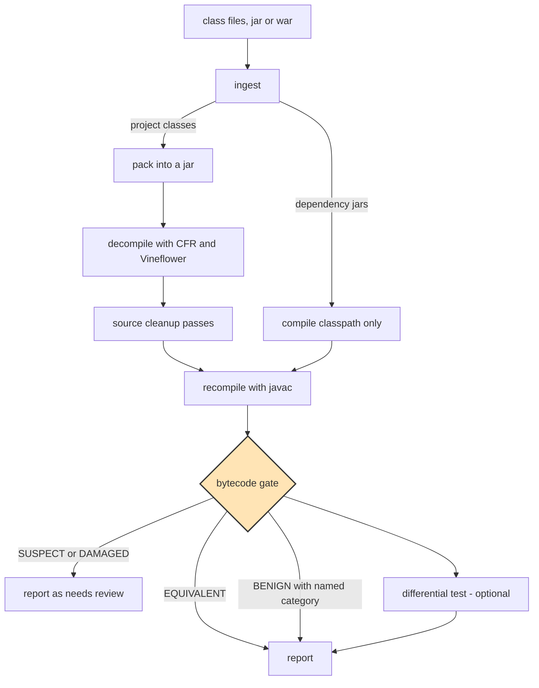

# anydecoder

**Recover Java source from class files — and prove the recovered source behaves the same.**

```
decompile  →  rebuild  →  compare the rebuilt bytecode with the original
```

A decompiler guesses at source. anydecoder checks the guess, mechanically, by recompiling what
came out and comparing the result against the class file it was derived from. A class whose
rebuild does the same things as the original is faithful. A class that does not is reported,
with the specific difference, instead of being quietly presented as recovered source.

[中文说明](README.zh-CN.md) · [如何判定](docs/verification.md) · [反编译陷阱目录](docs/pitfalls.md)

---

## Why this exists

Source gets lost. Build outputs get archived, the repository does not, and one day there is a
directory of `.class` files and no way to regain the code.

Decompilers are good and getting better, but their output has an awkward property: **it always
looks plausible.** A `finally` rendered as try-with-resources reads better than the original and
adds exception-suppression semantics the original never had. A local variable declared as
`FileWriter` instead of `Writer` compiles cleanly and binds to a different overload. Neither is
visible by reading. Both change what the program does.

The way out is not a better decompiler. It is a check that does not depend on reading:

> If you recompile the recovered source and the bytecode matches the original, the source is
> faithful — regardless of how it reads or what you think of it.

anydecoder is that check, plus everything needed to run it over a real project.

## What it establishes, and what it does not

**Establishes**, for each class it reaches:

- the exception table covers the same throwing instructions with the same handler types;
- the same methods, fields and field accesses are used;
- the same constants are loaded;
- the same number of rethrows appear;
- the shape is within a tolerance calibrated against real compiler differences.

**Does not establish:**

- that the source is what the author wrote. Variable names, comments, formatting, and whether a
  loop was written as `for` or `while` are not in the bytecode and are not claimed.
- anything about classes the gate did not reach. Coverage is reported next to every verdict for
  exactly this reason, and `HARNESS_ERROR` is never counted as a pass.
- runtime behaviour, except where differential testing is enabled — which closes the one
  structural blind spot the static comparison has. See [docs/verification.md](docs/verification.md).

## Quickstart

Requires JDK 17+ and Maven. The decompilers ship inside the jar, so there is nothing else to
install.

```bash
mvn -q package -DskipTests
```

Recover a project (a class directory, a jar, or a war):

```bash
java -jar anydecoder-cli/target/anydecoder.jar run path/to/classes \
  -o recovered \
  --deps path/to/WEB-INF/lib
```

You get `recovered/report.md`, `recovered/report.json`, and the source tree under
`recovered/work/src-cfr`.

### Give it memory

Give the launcher more heap than you would expect. Compiling a decompiled tree happens in-process
on the whole tree at once, and the peel repeats that until it converges, so the peak is a
property of the project rather than of the largest class:

```bash
java -Xmx8g -jar anydecoder-cli/target/anydecoder.jar run <classes> -o recovered
```

A few thousand classes needs more than 4 GB. Under-provisioning does not fail cleanly: the run
exhausts its heap one class at a time inside a parallel stream, and what surfaces is an error
about a class file rather than about memory. anydecoder recognises that case and says so, but the
heap still has to be raised.

Each decompiler runs as its own process with its own heap, set separately with
`-Danydecoder.engine.heap` — Vineflower builds a whole-project view and wants more than the
others. An engine that exhausts its memory is reported and stepped over rather than ending the
run.

Re-check after editing, without decompiling again:

```bash
java -jar anydecoder-cli/target/anydecoder.jar gate path/to/classes rebuilt/classes
```

Exit status is `0` when everything the gate reached is safe, `1` when something needs review.

## How it works



Only the project's own classes are decompiled. Dependency jars sit on the classpath so the
rebuild resolves the same types the original did — decompiling them would multiply the work while
answering a question nobody asked.

Two engines run by default, and the second is not only a cross-check. Decompilers fail on
different inputs, so **a file the first engine could not structure is replaced by the second's
rendering** before it is given up on. Whatever ends up in the tree is compiled and gated like
anything else, so a worse rendering is caught rather than preferred by assumption. The report
lists which files came from which engine.

### The gate

Per method, compared against the original:

| Signal | Catches | Hard? |
|---|---|---|
| `api` | a changed signature, field, or visibility | hard |
| `members` | a method the rebuild does not produce | hard |
| `excp` | a dropped `try`, a swallowed handler, a `finally` turned into try-with-resources | **hard** |
| `athrow` | a rethrow turned into a jump | hard |
| `invokes` | a duplicated or missing call, a rebound overload | hard |
| `fields` | a field touched on one side only, or as a different opcode | hard¹ |
| `consts` | a changed constant | hard |
| `instrCount` | code silently dropped or invented | suspect |
| `lvt` | a local declared with a wider or narrower type | advisory |
| `throws` | a declared exception the rebuild lost | advisory |

¹ A field touched on one side only is hard; the same field touched a *different number of times*
is `SUSPECT`, because a compiler may duplicate a store into each arm of a conditional. See
[the reasoning](docs/verification.md#fields--field-accesses--hard-with-a-caveat-about-counts).

The hard part is not the comparison, it is knowing what to ignore. Two compilers disagree about
constant-pool numbering, branch offsets, local variable slots, member order, synthetic accessor
names, exception-region segmentation and string-concatenation codegen. Every one of those is
normalised away, each because it was measured on real output and found to carry no meaning. What
is left is the set of differences that do.

### When something differs

A difference is not automatically a defect. Some are the compiler's own doing, and
anydecoder recognises those (`ECJ_BOOLEAN_MATERIALIZATION`, `ECJ_NO_IINC_OPTIMIZATION`,
`EXCEPTION_SEGMENT_SPLIT`, `STRING_CONCAT`, `ACCESSOR_NAMING`, `MEMBER_ORDER`,
`FINALLY_SELF_PROTECTION`, `FIELD_STORE_HOISTING`, `BOXING_MATERIALIZATION`).

Each recognition must name the structural pattern that produces the difference and show that it
is present. **There is no fallback to "probably harmless."** A difference nothing recognises
stays a difference, reaches the report, and says so with its evidence attached.

A class in this state is reported `BENIGN`, never `EQUIVALENT`. Both are safe; keeping them apart
means a reader can tell which classes were checked and matched from which were found to differ and
explained.

### Recording a divergence as accepted

Some divergences are correct and permanent — source deliberately changed after recovery differs
from the original by design, and no amount of investigating changes that. Left unrecorded, the
gate keeps naming classes somebody has already cleared, which trains its readers to ignore it.

So a decision can be recorded, in a Markdown table:

```markdown
| class | signal | reason | evidence |
|---|---|---|---|
| com/example/Foo | excp | local auth added after recovery | commit 03433271 |
```

**An entry must state why and cite evidence, or it is refused and reported.** A list of class
names saying "we looked at this" reads exactly like one saying "we gave up", and only one of those
is worth having. Matching is per class *and* per signal, so waiving one difference never hides
another.

A class whose remaining differences are all waived is reported `WAIVED` — safe, and deliberately
distinct from `BENIGN`, because one is a fact about compilers and the other is a decision that can
be argued with. Waivers that no longer match anything are reported too, since a list that only
grows stops being read. See [docs/verification.md](docs/verification.md#recording-a-divergence-as-accepted).

### Differential testing

The static gate compares structure, so two statements of the same kind swapped in order are
invisible to it — an operand swap in `a - b` produces an identical instruction multiset. That
limitation is documented rather than papered over, and closed where it can be:

```bash
java -jar anydecoder-cli/target/anydecoder.jar difftest <original-classes> <rebuilt-classes> \
  --deps path/to/deps
```

Both versions are loaded in separate classloaders and called with the same generated arguments,
and the results compared. Only public methods whose parameters are primitives, boxed primitives or
strings are driven; everything else is listed as skipped, because a run that drove nothing is not
evidence of equivalence. The seed is fixed and reported, so a divergence found in CI can be
reproduced exactly.

**It runs real code**, which is why the pipeline does not do it by itself. A method that writes
files or opens sockets will still write files or open sockets.

## The AI part

The mechanic above is not AI, and that is deliberate — a mechanical check is what makes the
result trustworthy. AI is used where judgement is genuinely required, and always under the gate:

- **Repairing a damaged class.** Read the disassembly, diagnose, rewrite, then re-gate. The
  verdict, not the model's confidence, is the answer.
- **Triaging a divergence.** Decide whether it is a real defect or a compiler artefact, with the
  structural evidence required either way.
- **Making correct-but-unreadable source readable.** `blockNN:` labels are valid Java that behaves
  exactly as the original did; rewriting them was previously blocked on a person convincing
  themselves it was safe. It is now a mechanical question, so the rewrite can be attempted freely.

The Claude Code plugin in [`claude-plugin/`](claude-plugin/) provides a skill, three agents and
two commands for this. The CLI works without it; the plugin drives it.

## Where this came from

The method is not invented here. It was worked out during a nine-day recovery of a production
Java web application whose source had been lost — 2984 class files, 2451 recovered source files,
compiled with the Eclipse compiler and recompiled with javac.

That effort found **6 real defects** among 2451 files that a compiler-based comparison could not
distinguish, and produced a 97.9% figure for classes verified as behaviourally equivalent. It also
produced four bugs in the checker itself, two of them silent — including a parser that discarded
every `finally` handler, so a source that had dropped its `finally` compared equal. All of that is
preserved here in [docs/verification.md](docs/verification.md) and
[docs/pitfalls.md](docs/pitfalls.md), and the four checker bugs are regression tests:
[`HistoricalRegressionTest`](anydecoder-core/src/test/java/com/anydecoder/core/gate/HistoricalRegressionTest.java).

**anydecoder finds two more.** Re-running the same corpus through this gate turned up **8** defects,
the extra two being a log message truncated from `集合深拷贝错误:` to `深拷贝错误:` and a dead local
the decompiler hoisted out of a `synchronized` monitor expression. Neither was visible to the
original checker: it compared call *counts* rather than targets, and had no constant signal at all.
The numbers are in [validation/RESULTS.md](validation/RESULTS.md).

anydecoder is the second version: the same method, done with a structured bytecode reader instead
of text parsing, and with the corpus kept as a standing validation.

## Building and testing

```bash
mvn verify
```

If your Maven installation points `central` at an internal mirror, pass a settings file:
`mvn -s /path/to/settings.xml verify`.

## Limits

- **The gate is as good as its signals.** It cannot see a swap of two independent statements of
  the same kind. Differential testing covers that where it is enabled and the method is drivable.
- **Unobfuscated bytecode only.** Obfuscated input — control-flow flattening, encrypted strings,
  renamed members — is out of scope for this version. The cleanup layer is an extension point.
- **Engines are pinned.** CFR 0.152 and Vineflower 1.11.1, because the gate's tolerance was
  calibrated against their output. Upgrading either is a change to what anydecoder validates, not
  a routine dependency bump.
- **Differential testing runs real code.** It is off by default for that reason.

## Licence

Apache License 2.0. See [LICENSE](LICENSE).
