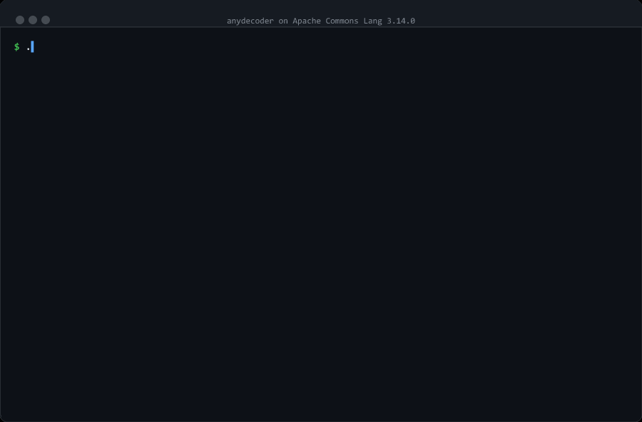

# anydecoder

[](https://github.com/anyanyna/anydecoder/actions/workflows/build.yml)
[](https://github.com/anyanyna/anydecoder/releases)
[](LICENSE)
[](https://github.com/anyanyna/anydecoder)

**Give your coding agent the ability to recover Java source from class files — and prove it got
it right.**

```
decompile  →  rebuild  →  compare the rebuilt bytecode with the original
```

anydecoder is a skill for Claude Code, Codex, Cursor and Trae, backed by a CLI. Point your agent at a
directory of `.class` files, a jar, or a war: it recovers the source, then proves the recovery is
faithful by recompiling it and comparing the result against the bytecode it came from. Whatever
cannot be proved is reported with its specific difference, not quietly handed over as recovered
source.

[中文说明](README.zh-CN.md) · [How it decides](docs/verification.md) · [Decompiler failure modes](docs/pitfalls.md)

---

## See it work



Decompile Apache Commons Lang — one of the most widely deployed Java libraries there is — and
check the result. About thirty seconds:

```bash
curl -LO https://repo1.maven.org/maven2/org/apache/commons/commons-lang3/3.14.0/commons-lang3-3.14.0.jar
java -Xmx4g -jar ~/.anydecoder/anydecoder.jar run commons-lang3-3.14.0.jar -o demo
```

It recovers 247 source files from 404 classes. **Nine of those 247 do not compile** under either
engine — and of the ones that do, the gate still finds a class that calls a *different method*
than the original, because the decompiler dropped an explicit cast the author had written.

That is ten problems in total: nine files that cannot be built, and one that builds but behaves
differently. A decompiler alone hands you all ten and says nothing.

[The full walkthrough, with the evidence for each →](examples/README.md)

## Why this exists

Source gets lost. Build outputs get archived, the repository does not, and one day all that
survives is a directory of `.class` files.

Here is the trap: a decompiler will always hand you something that **looks** right. A `finally`
rendered as try-with-resources reads *better* than the original while silently adding
exception-suppression semantics. A local declared as `FileWriter` instead of `Writer` compiles
cleanly and binds to a different overload. Neither is visible by reading. Neither fails a test that
already passed. Both change what the program does.

> Recompile the recovered source. If the bytecode matches the original, the source is faithful —
> regardless of how it reads or what you think of it.

That is a check which does not depend on reading — the only kind that can settle this. And an agent
is what makes it usable, because a real project produces hundreds of classes the checker cannot
clear on its own.

## What it can do

Turn a lost production application — 2,984 class files and nothing else — back into 2,451 source
files you can read, compile, and **point at evidence for**.

- **A whole project in one run.** A class directory, a jar, or a war goes in; a complete source
  tree and a report come out.
- **Every class backed by proof.** Nothing is handed to you because it looks right. Each class was
  recompiled and compared against the bytecode it came from.
- **The defects that would have shipped silently.** On a real corpus it found 8 defects a
  compiler-based comparison could not distinguish — a log message truncated mid-string, a dead
  local hoisted out of a `synchronized` monitor expression. Both compile. Both may pass tests.
  Both change behaviour.
- **An honest answer about the rest.** Coverage is printed beside every verdict, so you know what
  it did not verify as clearly as what it did. Very few tools in this space will tell you where
  they stopped looking — and that is precisely what makes the rest worth trusting.

Verdicts are `EQUIVALENT`, `BENIGN`, `WAIVED` (safe) or `SUSPECT`, `DAMAGED`, `HARNESS_ERROR`
(not safe). It will not claim the recovered names and comments are the author's — those are not in
the bytecode — and it will not vouch for a class it never reached.

[How it decides](docs/verification.md) covers the signals, the tolerances and the measurement each
came from, the recognised compiler artefacts, and the blind spots that are documented rather than
papered over.

## Quickstart

Two steps. Your agent does the rest.

### 1. Paste this into your agent

```
Install anydecoder. You will need a JDK 17+ to run it.

1. Download the CLI. It bundles the decompilers, so there is nothing to build:
     mkdir -p ~/.anydecoder
     curl -L -o ~/.anydecoder/anydecoder.jar \
       https://github.com/anyanyna/anydecoder/releases/latest/download/anydecoder.jar
2. Install the skill into your own skills directory, so you pick it up in this and future
   sessions. It is one file:
     mkdir -p <your-skills-dir>/anydecoder
     curl -L -o <your-skills-dir>/anydecoder/SKILL.md \
       https://github.com/anyanyna/anydecoder/releases/latest/download/SKILL.md
3. Confirm it runs: java -jar ~/.anydecoder/anydecoder.jar --version
```

Any agent that reads the [Agent Skills](https://agentskills.io) format can do this — Claude Code,
Codex, Cursor, Trae and the rest. It knows where its own skills live; you do not have to.

On Claude Code the agent can also load the whole plugin, which adds three repair subagents and two
slash commands: `claude --plugin-dir ~/.anydecoder/agents`.

### 2. Then just ask

```
Recover the source from build/classes and prove it's faithful.
```

```
We lost the source to this jar. Get it back, and tell me which classes you could not verify.
```

You get a source tree, a report, and a coverage number. **Read the coverage first** — a gate that
reached a tenth of the input has told you nothing about the other nine tenths.

Prefer to wire it up yourself? [Installing by hand](docs/installing.md).

## Using the CLI directly

Every step the agent takes is a command you can run yourself.

```bash
# the whole pipeline: decompile, clean up, rebuild, gate, report
java -Xmx8g -jar anydecoder-cli/target/anydecoder.jar run <classes|jar|war> \
  -o recovered --deps <dependency-jars>

# re-check after editing, without decompiling again
java -jar anydecoder-cli/target/anydecoder.jar gate <original-classes> <rebuilt-classes>

# call both versions and compare behaviour — the one thing the gate cannot see
java -jar anydecoder-cli/target/anydecoder.jar difftest <original-classes> <rebuilt-classes>
```

Exit status is `0` when everything the gate reached is safe, `1` when something needs review. Give
`run` more heap than you expect — a few thousand classes needs over 4 GB, and under-provisioning
does not fail cleanly. `difftest` **runs real code**, which is why the pipeline never invokes it by
itself.

## Where this came from

The method was worked out during a nine-day recovery of a production Java web application whose
source had been lost. That effort found **6 real defects** among files a compiler-based comparison
could not distinguish, and four bugs in the checker itself, two of them silent. Re-running the
same corpus through this gate found **8**. The numbers are in
[validation/RESULTS.md](validation/RESULTS.md).

## Documentation

| | |
|---|---|
| [Why this is needed](docs/index.md) | the long version, and what the check found on Commons Lang |
| [How anydecoder decides](docs/verification.md) | every signal, every tolerance, and the measurement it came from |
| [Decompiler failure modes](docs/pitfalls.md) | the defects this catches, and what only looks alarming |
| [Architecture](docs/architecture.md) | the pipeline, module by module |
| [Validation results](validation/RESULTS.md) | the numbers from a real corpus |

## Limits

- **The gate is as good as its signals.** It cannot see a swap of two independent statements of
  the same kind; differential testing covers that where it is enabled.
- **Unobfuscated bytecode only.** Control-flow flattening, encrypted strings and renamed members
  are out of scope for this version.
- **Engines are pinned** — CFR 0.152 and Vineflower 1.11.1 — because the gate's tolerance was
  calibrated against their output.
- **The agent is not the authority.** A plausible repair that does not satisfy the gate is still a
  failed repair.

## Licence

Apache License 2.0. See [LICENSE](LICENSE).
