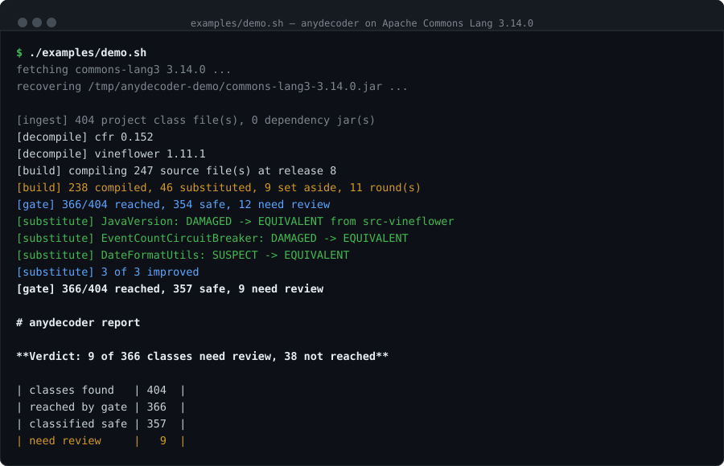

# anydecoder

**让你的编码 Agent 能恢复 Java 源码 —— 并证明它恢复对了。**

```
反编译  →  重新编译  →  拿重建的字节码与原 class 比对
```

anydecoder 是一份给 Claude Code、Codex、Trae 用的 skill，背后是一个 CLI。把 class 目录、jar
或 war 指给你的 Agent：它会恢复出源码，然后把源码重新编译、与它来源的那个 class 文件比对，
从而**证明**这次恢复是忠实的。证明不了的，会被报出来、附上具体差异，而不是被当成"已恢复的
源码"悄悄交出去。

[English](README.md) · [判定方法](docs/verification.md) · [反编译陷阱目录](docs/pitfalls.md)

---

## 为什么要做这个

源码是会丢的。构建产物进了归档，仓库没进，某一天你手上只剩一个 `.class` 目录。

陷阱在这里：反编译器**总会**递给你一个看起来对的东西。一个 `finally` 被渲染成
try-with-resources，读起来比原文还漂亮，却悄悄引入了异常抑制语义；一个局部变量被声明成
`FileWriter` 而不是 `Writer`，编译毫无问题，重载绑定却换了。这两件事读代码都看不出来，
已经通过的测试也抓不住。但它们都在改变程序行为。

> 把恢复的源码重新编译。如果字节码和原 class 对得上，源码就是忠实的 —— 不管它读起来像不像
> 原逻辑，也不管你怎么看它。

这是一个不依赖"读"的判据 —— 也是唯一能真正给出结论的一类。而 Agent 是让它变得可用的东西：
一个真实项目会产出几百个判据自己清不掉的类。

## 它可以实现什么

把一个源码已失传的生产系统 —— 只剩 2984 个 class 文件 —— 变回 2451 个可读、可编译、
**每一个都有据可查**的源码文件。

- **一次跑完整个项目。** class 目录、jar、war 都行，出来是一棵完整源码树加一份报告。
- **每个类都有据。** 没有任何一个类是"看着像"就交给你的 —— 每一个都重新编译过、与它来源的
  字节码比对过。
- **找得出会悄悄上线的缺陷。** 在真实语料上，它找出了 8 个用编译器比对分辨不出的真实缺陷 ——
  一段被截断的日志文本、一个被从 `synchronized` 监视表达式里提升出去的死局部变量。这两个都
  编译得过，测试可能也过，但行为已经变了。
- **对没做到的部分说实话。** 覆盖率与判定结果永远并排打印，所以它没验证什么，和它验证了什么
  一样清楚。这类工具里很少有谁愿意告诉你它在哪里停下了 —— 而这恰恰是剩下的结论值得相信的
  原因。

判定结果是 `EQUIVALENT`、`BENIGN`、`WAIVED`（安全）或 `SUSPECT`、`DAMAGED`、
`HARNESS_ERROR`（不安全）。它不会声称恢复出来的变量名和注释是作者写的 —— 那些不在字节码里；
也不会为它没覆盖到的类背书。

信号、每一个容差及其来源、能识别出的编译器行为、以及那些被写下来而不是被掩盖的盲区，都在
[判定方法](docs/verification.md) 里。

## 看看它实际跑起来



拿 Apache Commons Lang —— 部署最广的 Java 库之一 —— 反编译一遍再验证。大约三十秒：

```bash
curl -LO https://repo1.maven.org/maven2/org/apache/commons/commons-lang3/3.14.0/commons-lang3-3.14.0.jar
java -Xmx4g -jar ~/.anydecoder/anydecoder.jar run commons-lang3-3.14.0.jar -o demo
```

从 404 个 class 里恢复出 247 个源文件。**这 247 个里有 9 个根本编译不过**，两个引擎都救不回来。
而剩下那些能编译的里面，判据仍然抓到一个类**调用了和原著不同的方法** —— 因为反编译器丢掉了作者
写的一个强制转换。

只用反编译器，这十个问题你一个都不会知道。

[完整的走查过程与每一条的证据 →](examples/README.md)

## 快速开始

两步。剩下的交给你的 Agent。

### 1. 把这段粘贴给你的 Agent

```
安装 anydecoder。运行它需要一个 JDK 17+。

1. 下载 CLI。反编译器已经打包在里面，不需要构建：
     mkdir -p ~/.anydecoder
     curl -L -o ~/.anydecoder/anydecoder.jar \
       https://github.com/anyanyna/anydecoder/releases/latest/download/anydecoder.jar
2. 把 skill 装进你自己的 skills 目录，让当前和以后每个会话都能用上它。它就是一个文件：
     mkdir -p <你的-skills-目录>/anydecoder
     curl -L -o <你的-skills-目录>/anydecoder/SKILL.md \
       https://github.com/anyanyna/anydecoder/releases/latest/download/SKILL.md
3. 确认能跑：java -jar ~/.anydecoder/anydecoder.jar --version
```

读 [Agent Skills](https://agentskills.io) 规范的 Agent 都能做这件事 —— Claude Code、Codex、
Cursor、Trae 等等。它自己知道 skills 该放在哪，你不用管。

Claude Code 上还可以整个插件一起装，这样除了 skill 之外会多出三个修复用子 Agent 和两个斜杠命令：
`claude --plugin-dir ~/.anydecoder/agents`。

### 2. 然后直接说

```
把 build/classes 的源码恢复出来，并证明它是忠实的。
```

```
这个 jar 的源码丢了，帮我恢复。恢复完告诉我哪些类你验证不了。
```

你会拿到一棵源码树、一份报告，和一个覆盖率数字。**先看覆盖率** —— 只覆盖了十分之一的判据，
对另外十分之九什么结论也给不出。

想自己动手装？看 [手动安装](docs/installing.md)。

## 直接用 CLI

Agent 做的每一步，你都可以自己跑。

```bash
# 完整流水线：反编译、清理、重建、过判据、出报告
java -Xmx8g -jar anydecoder-cli/target/anydecoder.jar run <classes|jar|war> \
  -o recovered --deps <依赖-jar-所在目录>

# 改完源码后重新校验，不必再反编译一遍
java -jar anydecoder-cli/target/anydecoder.jar gate <原始-class> <重建-class>

# 两个版本都真正跑起来比对行为 —— 判据唯一看不见的那件事
java -jar anydecoder-cli/target/anydecoder.jar difftest <原始-class> <重建-class>
```

判据覆盖到的类全部安全时退出码为 `0`，有需要人工看的为 `1`。`run` 的堆要比你预期的大 —— 几千
个类需要 4GB 以上，而且给少了**不会干净地失败**。`difftest` **会真的执行代码**，所以流水线本身
不会主动跑它。

## 这个方法的来历

方法来自一次为期九天的生产环境 Java Web 应用源码恢复。那次工作找出了 **6 个真实缺陷**（与
"用编译器比对无法区分"的产物混在一起），以及**检查器自身的 4 个 bug，其中 2 个是静默的**。
把同一份语料重新过一遍现在的判据，找到的是 **8** 个。数字在
[validation/RESULTS.md](validation/RESULTS.md)。

## 文档

| | |
|---|---|
| [为什么需要它](docs/index.zh.md) | 长文版，以及判据在 Commons Lang 上发现了什么 |
| [判定方法](docs/verification.md) | 每一个信号、每一个容差，以及它来自哪次测量 |
| [反编译失败模式](docs/pitfalls.md) | 能抓到的真实缺陷，以及那些看着像问题其实没问题的 |
| [架构](docs/architecture.md) | 流水线，逐模块 |
| [验证结果](validation/RESULTS.md) | 真实语料上的数字 |

## 局限

- **判据的好坏取决于它的信号。** 它看不见两条同类型独立语句的交换；开启差分测试且方法可驱动
  时，这个盲区被补上。
- **只支持未混淆字节码。** 控制流平坦化、字符串加密、成员重命名等混淆输入在本版本范围之外。
- **引擎版本锁定** —— CFR 0.152 与 Vineflower 1.11.1 —— 因为判据的容差是针对它们的产物校准的。
- **Agent 不是权威。** 一个看着合理的修复，如果过不了判据，仍然是失败的修复。

## 许可

Apache License 2.0，见 [LICENSE](LICENSE)。
