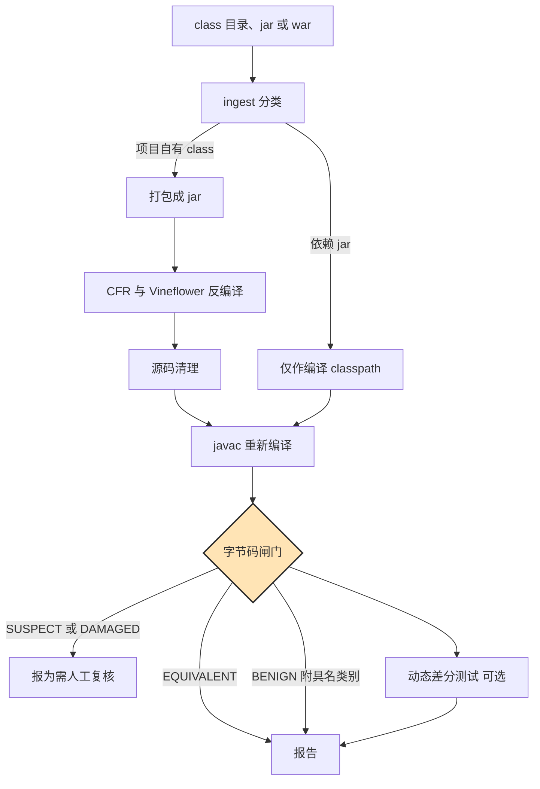

# anydecoder

**从 class 文件恢复 Java 源码 —— 并证明恢复出来的源码行为与原来一致。**

```
反编译  →  重新编译  →  拿重建的字节码与原 class 比对
```

反编译器是在猜源码。anydecoder 负责验证这个猜测：把反编译产物重新编译，再与它来源的那个
class 文件比对。重建结果与原 class 做同样的事，源码就是忠实的；做不到的会被报出来，附上
具体差异，而不是被当成"已恢复的源码"悄悄交出去。

[English](README.md) · [判定方法](docs/verification.md) · [反编译陷阱目录](docs/pitfalls.md)

---

## 为什么要做这个

源码是会丢的。构建产物进了归档，仓库没进，某一天你面对的就是一个 `.class` 目录，没有别的。

反编译器很好，也在变好，但它们的输出有个别扭的性质：**看起来永远都合理。** 一个 `finally`
被渲染成 try-with-resources，读起来比原文还漂亮，却引入了原文没有的异常抑制语义；一个局部
变量被声明成 `FileWriter` 而不是 `Writer`，编译毫无问题，重载绑定却换了。这两件事读代码
都看不出来，都会改变程序行为。

出路不是换一个更好的反编译器，而是一个不依赖"读"的判据：

> 把恢复的源码重新编译，如果字节码和原 class 对得上，源码就是忠实的 —— 不管它读起来像不像
> 原逻辑，也不管你怎么看它。

anydecoder 就是这个判据，外加跑通一个真实项目所需的一切。

## 它证明了什么，没证明什么

**能证明**（对每个闸门覆盖到的类）：

- 异常表保护的是同一批会抛异常的指令，处理器类型一致；
- 调用的方法、访问的字段一致；
- 加载的常量一致；
- `athrow` 次数一致；
- 形态差异在按真实编译器差异校准过的容差之内。

**不能证明**：

- 源码是作者当时写的样子。变量名、注释、格式、循环写成 `for` 还是 `while`，都不在字节码里，
  不作任何声称。
- 闸门没覆盖到的类，什么都不能说。所以覆盖率永远与判定结果并排打印，`HARNESS_ERROR` 永远
  不计入通过。
- 运行时行为 —— 除非开启了动态差分测试，它封住了静态比对仅有的那个结构性盲区。

## 快速开始

需要 JDK 17+ 和 Maven。反编译器打包在 jar 里，不需要另外装。

```bash
mvn -q package -DskipTests
```

恢复一个项目（class 目录、jar 或 war）：

```bash
java -jar anydecoder-cli/target/anydecoder.jar run path/to/classes \
  -o recovered \
  --deps path/to/WEB-INF/lib
```

得到 `recovered/report.md`、`recovered/report.json`，以及 `recovered/work/src-cfr` 下的源码树。

改完源码后重新校验，不必再反编译一遍：

```bash
java -jar anydecoder-cli/target/anydecoder.jar gate path/to/classes rebuilt/classes
```

闸门覆盖到的类全部安全时退出码为 `0`，有需要人工看的为 `1`。

## 工作原理



只反编译项目自己的 class。依赖 jar 只放在 classpath 上，让重建时能解析到与原版相同的类型 ——
反编译它们会让工作量翻倍，却回答不了任何有人关心的问题。

### 闸门比对的信号

逐方法，与原 class 比对：

| 信号 | 抓什么 | 硬判据? |
|---|---|---|
| `api` | 签名、字段、可见性被改 | 硬 |
| `members` | 重建缺少某个方法 | 硬 |
| `excp` | `try` 被丢、处理器被吞、`finally` 被渲染成 try-with-resources | **硬** |
| `athrow` | rethrow 被改成跳转 | 硬 |
| `invokes` | 调用重复或缺失、重载绑定被换 | 硬 |
| `fields` | 字段访问被改、实例与静态互换 | 硬 |
| `consts` | 常量被改 | 硬 |
| `instrCount` | 代码被静默丢弃或凭空生成 | 存疑 |
| `lvt` | 局部变量声明类型被放宽或收窄 | 仅参考 |

难的不是比对，是**知道该忽略什么**。两个编译器在常量池编号、跳转偏移、局部变量槽位、成员
顺序、合成访问器命名、异常保护区间切分、字符串拼接代码生成上全都不一致。每一条都被归一化
掉了，而每一条之所以被归一化，都是因为在真实产物上量过、确认不携带语义。剩下的才是真正有
意义的差异。

### 差异不等于缺陷

有差异不代表有缺陷，有些是编译器自己的行为。anydecoder 能识别这些：
`ECJ_BOOLEAN_MATERIALIZATION`、`ECJ_NO_IINC_OPTIMIZATION`、`EXCEPTION_SEGMENT_SPLIT`、
`STRING_CONCAT`、`ACCESSOR_NAMING`、`MEMBER_ORDER`、`FINALLY_SELF_PROTECTION`、
`FIELD_STORE_HOISTING`、`BOXING_MATERIALIZATION`。

每一类都必须**指出产生该差异的结构模式，并证明它确实存在**。没有"大概无害"这种兜底。任何
识别不出来的差异仍然是差异，会带着证据进报告。

这种类的判定是 `BENIGN`，不是 `EQUIVALENT`。两者都安全，分开记是为了让人能分清"比对了、
对得上"和"发现了差异、已解释清楚"。

### 动态差分测试

静态闸门比对的是结构，所以两条同类型语句交换顺序是它看不见的 —— `a - b` 里换个操作数顺序，
指令多重集完全一样。这个局限写在文档里而不是被掩盖，并且在能覆盖的地方被补上：开启差分测试
后，原始版本与重建版本会被装进两个独立的类加载器，用同一批生成的参数调用，比对结果。

## AI 用在哪

上面这套机制不是 AI，这是刻意的 —— 正因为它是机械判据，结论才可信。AI 只用在做判断真正必要
的地方，且始终在闸门之下：

- **修复受损的类**：读反汇编、诊断、改写，然后重跑闸门。答案是判定结果，不是模型的信心。
- **裁决差异**：判断是真实缺陷还是编译器行为，两种情况都必须给出结构证据。
- **把"正确但难读"的源码变可读**：`blockNN:` 标签是合法 Java，行为与原文完全一致；过去要改
  它得先说服自己"这么改不影响逻辑"，现在这是个机械问题，可以放手改。

[`claude-plugin/`](claude-plugin/) 下提供了 skill、三个 agent 和两个命令。CLI 可以独立使用，
插件负责驱动它。

## 这个方法的来历

方法不是在这里发明的。它来自一次为期九天的生产环境 Java Web 应用源码恢复 —— 2984 个 class
文件，恢复出 2451 个源码文件，原始产物由 Eclipse 编译器 ecj 编译，用 javac 重建。

那次工作在这些文件里找出了 **6 个真实缺陷**，它们与"用编译器比对无法区分"的产物混在一起；
最终结论是 97.9% 的类经证明行为等价。同时，它还暴露了**检查器自身的 4 个 bug，其中 2 个是
静默的** —— 包括一个解析器丢掉了所有 `finally` 处理器，导致一个删掉了 `finally` 的源码被判为
一致。这些全部保留在 [docs/verification.md](docs/verification.md) 与
[docs/pitfalls.md](docs/pitfalls.md) 中，那 4 个 bug 变成了回归测试：
[`HistoricalRegressionTest`](anydecoder-core/src/test/java/com/anydecoder/core/gate/HistoricalRegressionTest.java)。

anydecoder 是第二版：同样的方法，改用结构化字节码读取而非文本解析，并把语料作为长期验证保留
下来。

## 构建与测试

```bash
mvn verify
```

如果你的 Maven 把 `central` 指向了内网镜像，加一个 settings 文件：`mvn -s /path/to/settings.xml verify`。

## 局限

- **闸门的好坏取决于它的信号。** 它看不见两条同类型独立语句的交换。开启差分测试且方法可驱动
  时，这个盲区被补上。
- **只支持未混淆字节码。** 控制流平坦化、字符串加密、成员重命名等混淆输入在本版本范围之外。
  清理层是预留的扩展点。
- **引擎版本锁定。** CFR 0.152 与 Vineflower 1.11.1，因为闸门的容差是针对它们的产物校准的。
  升级其中任何一个，都是改变了 anydecoder 的验证对象，而不是例行升级依赖。
- **差分测试会真的执行代码**，因此默认关闭。

## 许可

Apache License 2.0，见 [LICENSE](LICENSE)。
