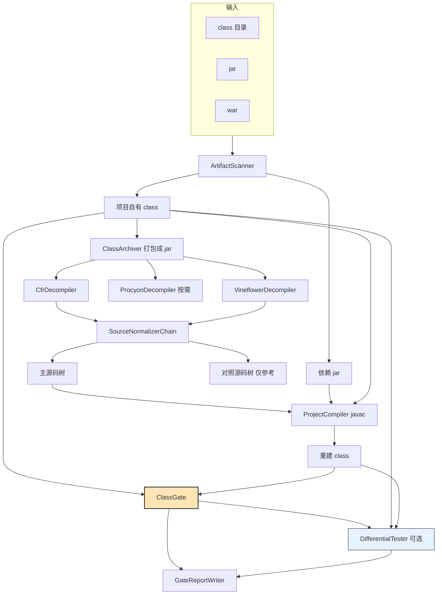

# Architecture

## The pipeline

The order is load-bearing. Decompiling comes first because everything downstream needs source.
Recompiling comes before the gate because the gate's claim is about a **rebuild**: comparing
recovered source against original bytecode directly would mean comparing a text to a binary and
settling it by judgement, which is the guessing this tool exists to replace.

## Modules

| Module | Contains |
|---|---|
| `anydecoder-core` | everything below |
| `anydecoder-cli` | picocli front end, shaded into `anydecoder.jar` |
| `agents` | one skill in the Agent Skills format, plus the Claude Code plugin's agents and commands; no build step |

### `ingest`

`ArtifactScanner` sorts a directory, jar or war into project classes and dependency jars. The
distinction decides a two-hour job versus a two-week one, and it cannot be made from the class
files: `WEB-INF/classes` beside `WEB-INF/lib` is the usual signal, and a bare directory of classes
is taken at face value.

`ClassArchiver` packs the project classes into a jar before any engine sees them. Decompilers
handle jars far more reliably than directories — CFR 0.152 does not recognise a class directory at
all, and falls back to treating the path as a class name.

### `engine`

One class per decompiler, all launched as **subprocesses**. Each ships its own copies of shared
libraries and some call `System.exit`; a subprocess keeps those concerns out and lets one engine
fail without taking the run down.

`ToolCache` resolves each engine's jar: an explicit path, then the run's tools directory, then the
copy bundled inside anydecoder's own artifact, then a download from Maven Central. The bundled
copy is why a normal install never reaches the fourth step, and the pinned version is why every
user of a given release compares against the same engine behaviour.

The tools directory is `<work-dir>/.tools` by default — beside the run's scratch space rather than
in the user's home directory, so a project kept on another drive causes nothing to accumulate on
the system drive. `-Danydecoder.tools` puts it wherever a caller prefers, which is worth doing if
several runs should share one copy.

Engine exit codes are treated as advisory. CFR exits non-zero for classes it merely found
uninteresting, so a non-zero exit is fatal only when no source was produced.

### `normalize`

Source cleanup, applied optimistically. None of the passes has to be right, because the run
recompiles and re-gates afterwards: a pass that changed behaviour shows up as a worse verdict and
can be reverted.

That is the reason it is safe to attempt an edit whose safety is not obvious by inspection. The
alternative — refusing to touch anything that cannot be proved safe from the text alone — is how a
tool ends up shipping a tree nobody wants to read.

`JavaText` supplies comment- and literal-aware helpers. Every one of them has to be aware of
string and character literals: a regular expression that strips `//` without that awareness will
delete the tail of `String url = "http://example.com";`, and the result still compiles into
something that does a different thing.

### `build`

`ProjectCompiler` drives the compiler API in-process rather than shelling out. The original
toolchain parsed javac's standard error, and its error counter never worked: the build forced
English diagnostics for stability while the counter matched the Chinese word for "error", so it
reported zero errors on every failing build. Structured diagnostics remove the entire class of
problem, along with the encoding handling.

The `--release` is taken from the original classes' major version. Compiling Java 8 bytecode's
source at release 17 changes string concatenation to `invokedynamic`, and every concatenating
method would then differ for reasons unrelated to the source.

`SourceTreeCompiler` wraps it with a **peel**, and it exists because javac emits no class files
at all when any file fails to compile. On the validation corpus, 2451 decompiled files produced
100 compiler errors and the gate therefore reached **zero** classes: not because the source was
unusually bad — that is what raw decompiler output looks like — but because one broken file
blocked the whole rebuild.

The peel compiles everything; if that fails, it takes the files the compiler named and either
**substitutes another engine's rendering** or sets them aside, then compiles again. References from
the remaining files to the ones set aside resolve against the original class files on the
classpath, so setting one aside does not cascade. The cost is a handful of whole-tree compiles
rather than the thousands an isolated per-file compile would need — the approach the original
toolchain used, at roughly six seconds per file.

The substitution is worth stating plainly, because it is the reason running two engines matters.
Decompilers fail on different inputs, and a file the first could not structure is often one the
second handled. Discarding the second engine's tree after using it only as a cross-check leaves
its most useful output on the floor. The substituted file is compiled and gated like anything
else, so a worse rendering is caught by the comparison rather than preferred by assumption, and
the report names which files came from where.

What the peel produces is two lists that call for different work:

- **source defects** — the decompiler lost the structure and the file will not parse. Each carries
  the compiler's own message. This is the repair worklist.
- **APIs the JDK no longer ships** — `sun.misc.BASE64Encoder` and the like cannot be rebuilt on a
  modern JDK at all, since the class was removed in Java 9 and no `--release` brings it back.
  Nothing is claimed about those classes either way, and reporting them beside a structure
  collapse would send a reader to repair source that is fine.

### `gate`

`ClassModelReader` builds a `ClassModel` with ASM. This replaced `javap` text scraping, which
produced four defects in the checker itself, two of them silent — see
[verification.md](verification.md#four-bugs-this-checker-shipped-with).

Exception-table positions are expressed as **instruction indices**, not bytecode offsets. Offsets
differ between compilers for reasons that carry no meaning, and ASM only guarantees label offsets
after a class has been written. Indices are stable and are all the normaliser needs.

`ClassGate` runs the signals per method and hands the divergences to
`BenignDivergenceClassifier`, which can only excuse a difference by naming the structural pattern
that produces it.

### `difftest`

Loads the original and the rebuild in separate classloaders — parented to the platform loader, so
neither tree can see the other and nothing from anydecoder's own classpath can shadow a class
under test — and calls both with generated arguments.

Containment: only public methods with primitive, boxed or `String` parameters; a fresh receiver per
invocation; a case cap; and off by default, because it runs real code.

### `report`

Markdown for a person, JSON for a program. Neither ever reports a bare pass rate: coverage appears
next to the verdicts, because "0 damaged classes" means something very different at 12% coverage
than at 100%.

## Threading

Gating is the only parallel step and runs on the common pool. `ClassGate` is stateless; models are
read per class and discarded. Nothing else is parallel: the decompilers are subprocesses that
manage their own threads, and compiling in parallel multiplies the memory the compiler needs for
no wall-clock benefit at typical project sizes.

## Extension points

- **A decompiler**: implement `Decompiler`, register it in `DecoderPipeline.engineFor`, add its
  artifact to `ToolCache`. All three engines are subprocess wrappers, so a new one is roughly
  thirty lines.
- **A cleanup pass**: implement `SourceNormalizer` and add it to `SourceNormalizerChain.standard()`.
  The gate is the backstop, so a pass is safe to attempt.
- **A gate signal**: implement `Signal` and register it in `ClassGate`. It must come with the
  measurement that justifies its tolerance — see
  [verification.md](verification.md#extending).
- **A bytecode transform** (for obfuscated input, which is out of scope for this version): the
  cleanup layer is the place, since passes there are already applied under gate supervision.
