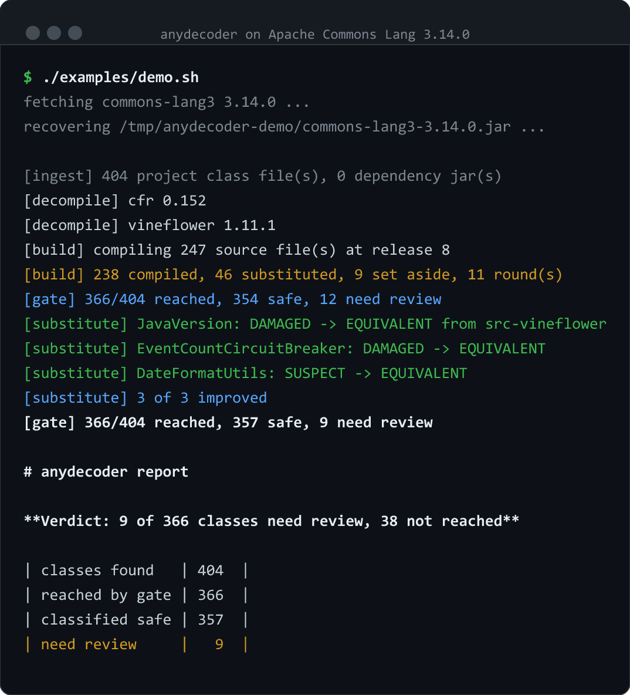

# See it work

```bash
./examples/demo.sh
```

Downloads Apache Commons Lang 3.14.0, decompiles its 404 class files, recompiles what came out,
and compares the result against the bytecode it came from. About thirty seconds, most of it
compilation.

Nothing here is a fixture prepared for the occasion. It is a library that ships inside a very
large number of Java applications, and the findings are whatever the two engines actually produce
on it.



## What you get

```
[build] compiling 247 source file(s) at release 8
[build] 238 compiled, 46 substituted from another engine, 9 set aside, 11 round(s)
[gate] 366/404 reached, 354 safe, 12 need review
[substitute] org/apache/commons/lang3/JavaVersion: DAMAGED -> EQUIVALENT from src-vineflower
[substitute] org/apache/commons/lang3/concurrent/EventCountCircuitBreaker: DAMAGED -> EQUIVALENT from src-vineflower
[substitute] org/apache/commons/lang3/time/DateFormatUtils: SUSPECT -> EQUIVALENT from src-vineflower
[substitute] 3 of 3 improved
[gate] 366/404 reached, 357 safe, 9 need review
```

Three things in there are worth noticing, because they are the difference between a check and a
claim.

**It compiles at the original's release.** `at release 8` — Commons Lang 3.14.0 is a Java 8
artifact, so the rebuild is a Java 8 rebuild. Compiling at a newer release would turn every
string-concatenating method into a false positive, since from Java 9 concatenation is
`invokedynamic`.

**A second engine is a fallback, not only a cross-check.** 46 of the 247 files are Vineflower's
rendering, because CFR's did not survive recompilation. Whatever ends up in the tree is then
compiled and gated like everything else, so a worse rendering is caught rather than preferred.

**The gate sends failures back for a second opinion.** It was unhappy with twelve classes; both
renderings of three of them were tried, and Vineflower's version of `JavaVersion` and
`EventCountCircuitBreaker` changed the verdict from `DAMAGED` to `EQUIVALENT`. That is not the
gate relaxing — it is the gate getting a better answer.

| | |
|---|---:|
| classes found | 404 |
| reached by the gate | 366 (90.6%) |
| classified safe | 357 |
| need review | 9 |

`EQUIVALENT` 350 · `BENIGN` 7 · `SUSPECT` 6 · `DAMAGED` 3 · `HARNESS_ERROR` 38.

## First: nine of the recovered files do not compile

The 38 classes the gate never reached are not a mystery and not a pass. The rebuild produced no
class file for any of them, and every one traces back to one of nine recovered source files that
`javac` refused. These are the errors, verbatim:

```
ArrayUtils.java                    method getComponentType in class ClassUtils cannot be applied
                                     to given types; required: Class<T[]>, found: Class<T>
EnumUtils.java                     incompatible types: Enum cannot be converted to E
ObjectUtils.java                   clone() has protected access in java.lang.Object
ThreadUtils.java                   reference to findThreads is ambiguous; both
                                     findThreads(Predicate<Thread>) and
                                     findThreads(ThreadUtils.ThreadPredicate) match
FieldUtils.java                    reference to readField is ambiguous; both
                                     readField(Field, Object, boolean) and
                                     readField(Object, String, boolean) match
StrBuilder.java                    method does not override or implement a method from a supertype
AbstractConcurrentInitializer.java unreported exception capture#1 of ? extends Exception
ExceptionUtils.java                unreported exception java.lang.Throwable
module-info.java                   modules are not supported in -source 8
```

Read that list again, because it is the argument for this tool in nine lines. **A decompiler
alone hands you all of these and says nothing.** The source looks like Java, the files have the
right names, and you find out that three and a half percent of the tree does not build at the
moment you try to build it — which, if you are recovering a project whose build you already lost,
may be some time later.

Two of the nine say `ambiguous`, which is the same failure the next section is about, in a form
loud enough that the compiler catches it for you. The other seven are as many different ways for
a decompiler to lose something the original had.

## Then: the ones that do compile are not automatically right

`report.json` lists the nine classes needing review. Here is the first, in full — this is what the
tool is for.

```
class    org/apache/commons/lang3/reflect/TypeUtils
verdict  DAMAGED
member   getClosestParentType(Class, Class)
signal   invokes (hard)
detail   the set of members differs:
           only in original  TypeUtils.isAssignable(Type, Type)
           only in rebuild   TypeUtils.isAssignable(Type, Class)
```

The recovered source for that method reads perfectly:

```java
if (isAssignable(midClass, superClass) && isAssignable(genericInterface, midClass)) {
```

It compiles. It passes review. And it calls a **different method** than the original did.

Here is the original source of Commons Lang 3.14.0:

```java
if (isAssignable(midClass, superClass)
        && isAssignable(genericInterface, (Type) midClass)) {
```

There is the answer: `(Type) midClass`. The author wrote an explicit cast to force the
`isAssignable(Type, Type)` overload, because `midClass` is declared `Class<?>` and without the
cast javac picks the narrower `isAssignable(Type, Class)`.

**The decompiler dropped the cast.** You can watch it happen. Disassemble the original and the
call target is right there:

```
109: invokestatic  // Method isAssignable:(Ljava/lang/reflect/Type;Ljava/lang/Class;)Z
118: invokestatic  // Method isAssignable:(Ljava/lang/reflect/Type;Ljava/lang/reflect/Type;)Z
```

Two different methods at two adjacent offsets. The rebuild calls the first one twice.

### What the tool does and does not say

It does not say Commons Lang is broken. Here the two overloads agree: `isAssignable(Type, Type)`
delegates to `isAssignable(Type, Type, Map)`, which dispatches straight back to
`isAssignable(Type, Class)` when the target is a `Class`. So the recovered source probably behaves
identically, and you can check that in the source above rather than taking anyone's word for it.

What the tool says is narrower, and it is a fact: **the recovered source calls a different method
than the original did.** Whether that matters is exactly the judgement it refuses to make for you.
The reason it says `DAMAGED` rather than `EQUIVALENT` is that nothing in the bytecode separates
"a cast was dropped and it happens to be harmless" from "a cast was dropped and the program now
does something else" — and the second one is what `ThreadUtils` and `FieldUtils` are.

A decompiler cannot tell you which side of that line you are on. This one shows you where to look.

## Working through the rest

```bash
cat "$TMPDIR/anydecoder-demo/out/report.json"     # every finding, with its evidence
less "$TMPDIR/anydecoder-demo/out/report.md"      # the same, as a document
ls   "$TMPDIR/anydecoder-demo/out/work/src-cfr"   # the recovered source
```

The eight remaining entries are the same exercise. All six `SUSPECT` ones are `MutableInt` and its
neighbours under `mutable/`, and they show what `SUSPECT` is for. The original is:

```java
final int last = value;
value++;
return last;
```

Three field touches: read into a local, increment the field, return the local. The decompiler
folds that into `return this.value++;`, which touches the field twice. Same answer, one fewer
read — and the gate still will not call it a match, because a compiler produces that same shape
from other source too, so the count alone does not prove the source was this one.

Handing a list like that to an agent is what the [skill](../agents/skills/anydecoder/SKILL.md) is
for.
